# SketchBook Tesi

In questa repository si trova tutto il materiale raccolto e prodotto per la tesi di laurea magistrale. Al momento la "roadmap" dei primi esperimenti è la seguente:

## TODO

1. [X] Rileggere i paper che mi erano stati forniti per il laboratorio.
2. [X] Eseguire alcuni esperimenti preliminari con uno o più VLM, in modo da ottenere una baseline e analizzarne i risultati.
3. [-] Approfondire meglio il funzionamento degli agenti, la rappresentazione della conoscenza in Prolog e riguardare il sistema Aleph.
4. [ ] Sviluppare una prima pipeline per estrarre i predicati dalle istanze del benchmark (KANDY) e convertirli in rappresentazione simbolica.
5. [ ] Utilizzare Aleph per provare ad apprendere regole a partire dagli esempi etichettati e valutarne i risultati.
6. [ ]
7. [ ]
8. [ ]
9. [ ]
10. [ ]

---

## Fonti Utilizzate

- Bongard in Wonderland: Visual Puzzles that Still Make AI Go Mad?[https://arxiv.org/pdf/2410.19546]
- BONGARD-RWR+: REAL-WORLD REPRESENTATIONS OF FINE-GRAINED CONCEPTS IN BONGARD PROBLEMS[https://arxiv.org/pdf/2508.12026]
- BONGARD-LOGO: A New Benchmark for Human-Level Concept Learning and Reasoning[https://arxiv.org/pdf/2010.00763]
- The KANDY Benchmark: Incremental Neuro-Symbolic Learning and Reasoning with Kandinsky Patterns[https://arxiv.org/pdf/2402.17431]
- 
-
-
-

---

## Prima parte: 

Tutti gli appunti presi durante la rilettura si trovano nel README della cartella Appunti_Papers. Per la seconda parte andrò a utilizzare i concetti che seguono.


<details>
<summary>Appunti sui paper: Bongard in Wonderland, BONGARD-RWR+, BONGARD-LOGO e KANDY</summary>

### Da Bongard in Wonderland

1. Il fatto che un VLM descriva correttamente un'immagine, non significa che riesca a capire quale sia la regola astratta che lega quella immagine ad altre immagini e la separa dalle altre.
2. Il modello può dare la risposta giusta senza aver "in mente" il concetto: può azzeccare per caso o per via di un forte pre-training sul problema proposto.
3. Si cerca dunque di formulare degli esperimenti per capire se il modello "capisca" le regole astratte che legano delle immagini oppure le indovini e basta.
4. Il paper valuta tre caratteristiche fondamentali:
   - riconoscimento: ovvero il modello risponde correttamente alla domanda "in questa immagine c'è un triangolo"?
   - induzione: ovvero il modello riesce a formulare la regola che collega tra di loro le varie immagini.
   - applicazione: una volta nota la regola, il modello riesce a stabilire con certezza se l'immagine possiede o non possiede quella regola.
5. Gli autori propongono tre test principalmete:
   - Ricevute 12 immagini, 6 gruppo a e 6 gruppo b, stabilire quali sono le regole dei due gruppi.
   - Data la coppia di regola vengono proposte singolarmente le 12 immagini e il modello deve capire se vale a oppure b.
   - Il modello vede le 12 immagini e deve produrre 20 ipotesi tra cui quella giusta.
7. Gli autori individuano 4 comportamenti per i vlm:
    - Tipo I   :  il modello fa bene i primi due test ma non riesce nel terzo; non succede quasi mai, l'idea è che se il modello stabilisce la regola e la riconosce negli esempi allora riesce anche a generarla nelle 20 ipotesi
    - Tipo II  :  il modello fa bene gli utlimi due test; significa che il modello non riesce a "unire i puntini", gli autori mostrano che c'è un numero discreto di errori di questo tipo, l'errore suggerisce una mancanza nel riuscire appunto a integrare la percezione col ragionamento. 
    - Tipo III :  il modello fa bene il primo e il terzo; capisce cioè la regola generale ma non riesce a ritrovarla nelle singole istanze, gran parte degli errori che il modello compie appartengono a questa categoria, ovvero il modello quando si tratta di capire il quadro generale eccelle, mentre pecca nel particolare (ciò potrebbe essere dovuto anche all'architettura dei vit e transformer in generale ma ciò richiederebbe un'analisi più approfondita).
    - Tipo IV  :  il modello si comporta bene in tutti e tre i test

### Da BONGARD-RWR+

1. Si utilizza un dataset sintetico simile a Bongard-Hoi e discendente diretto di Bongard-RWR, il quale ci permette di verficare la capacità del modello di estrarre concetti astratti da immagini reali
3. Gli autori stabiliscono 4 comportamenti chiave:
   - Percezione  : il modello riesce a ricavare info visive pertinenti
   - Confronto   : il modello riesce a stabilire quale regola divide i due gruppi
   - Selezione   : il modello riesce a scegliere la coppia di regole giusta
   - Generazione : il modello riesce a generare la regola corretta
4. Gli autori stabiliscono poi sei esperimenti chiave:
    - Il modello riceve le dodici immagini di contesto e una singola immagine di test. Deve stabilire se quest'ultima appartenga al gruppo sinistro oppure al destro; misura la capacità di utilizzare il contesto per assegnare un nuovo esempio alla categoria corretta
    - Il modello riceve entrambe le immagini di test, una per ciascun lato, e deve assegnarle ai rispettivi gruppi; misura la capacità di classificare due esempi in presenza dello stesso contesto, con una possibile difficoltà aggiuntiva legata alla coerenza fra le risposte
    - Prima, un modello image-to-text trasforma le immagini di contesto e di test in descrizioni linguistiche. Poi un modello testuale utilizza queste descrizioni per assegnare l'immagine di test al gruppo corretto; misura la capacità di classificare due esempi sulla base di descrizioni linguistiche, mantenendo la distinzione fra i due concetti
    - Si applica la stessa idea del D1S, ma alle due immagini di test. Entrambe vengono descritte in linguaggio naturale e il modello deve assegnarle ai lati corretti; misura La capacità di classificare due esempi sulla base di descrizioni linguistiche, mantenendo la distinzione fra i due concetti
    - Il modello riceve la matrice Bongard e un insieme di concetti candidati. Deve selezionare quello che descrive correttamente la distinzione fra i due gruppi; misura la capacità di identificare il concetto corretto fra alternative esplicitamente disponibili
    - Il modello riceve la matrice e deve descrivere autonomamente in linguaggio naturale il concetto che distingue i due gruppi. Gli autori esaminano sia la generazione da immagini sia quella da descrizioni linguistiche; misura la capacità di produrre una spiegazione linguistica della regola senza avere a disposizione una lista di risposte candidate
5. Vengono stabilite tre tipi di risultati:
   - Prestazioni basse con input visivi, alte con input testuali; difficoltà nella percezione
   - Prestazione basse con generazione e alte in selezione; difficoltà nella formulazione
   - Prestazioni migliori con una sola immagine rispetto che due; difficoltà di mantenere coerenti due classificazioni ma anche differenze nei prompt e nel formato dell'output

### Da BONGARD-LOGO

1. Gli autori fanno notare che mentre gli umani, anche i bambini, riescono a generalizzare anche con pochi dati a disposizione, le macchine invece sembrano avere bisogno di ingenti quantità di dati e spesso non riescono a generalizzare alla stessa maniera
2. Gli autori dunque vorrebbero far passare i modelli dal semplice pattern-recognition alla capacità di generalizzazione degli umani
3. I bongard originali sono 100 quesiti, ma per addestrare un modello sono pochi, quindi si passa a 12.000 problemi. Il modello osserva 6 esempi positivi, 6 negativi e poi classifica nuovi esempi. Si tratta di un task di classificazione few-shot
4. Nel paper gli autori individuano 3 proprietà fondamentali della cognizione umana:
   - Context-dependent Perception: cioè una stessa configurazione può essere interpretata differentemente in base al contesto in cui si trova, (ex. un un triangolo equilatero ha un significato diverso se è mostrato assieme ad altri 5 triangoli o ad altri 5 poligoni regolari). In altre parole la percezione P dell'umano può essere espressa come una funzione dell'oggetto visivo X e del contesto C, cioè P(X,C).
   - Analogy-making perception: cioè gli umani possono reinterpretare una struttura visiva attraverso un concetto differente, trasferendo alla nuova rappresentazione caratteristiche che la definiscono. (ex. posso interpretare una sequenza di zigzag come una linea, oppure quattro triangoli alla stessa distanza tra loro con quattro angoli retti tra di loro come un quadrato)
   - Few sample, infinite vocabulary: gli umani anche da pocchissimi esempi riescono a identificare quelle caratteristiche che vanno a definire la "matrice" di tutti i possibili problemi. I modelli dunque non possono semplicemente limitarsi a riconoscere un insieme finito di forme, ma deve riuscire ad apprendere come viene generato il nuovo concetto. (ex. vogliamo addestrare il modello su traingolo e quadrato ma vogliamo che poi, in autonomia, capisca che mettendo il triangolo sopra il quadrato si ottenga una casa.)

### Da KANDY

1. Binding problem: associare correttamente le caratteristiche percettive ai singoli oggetti.
2. L'idea è quella di far imparare prima concetti semplici e poi farli riutilizzare in task via va più complessi.
8. Come funziona la generazione degli esempi:
    1. Definizione task: si specificano regole positivem negative, proprietà, operatori, numero di esmepi e impostazioni di supervisione.
    2. Generazione simbolica: si costruiscono gli alberi di composizione a partire dalle regole yaml.
    3. Il sistema controlla che gli alberi non siano ridondanti e, quando è disponibile, verifica la compatibilità con la regola prolog.
    4. Rendering immagini: gli alberi diventano immagini andando ad applciare alcune variazioni percettive
    5. Assegnazione supervisione: a ogni campione viene associato supervised o unsupervised a seconda della specifica.
    6. Gli esempi vengono separati nei gruppi di trainig, validation e test.

</details>

---

## Seconda Parte:

In questa seconda parte andremo a eseguire dei test sui VLM scelti; prima, tuttavia dobbiamo concentrarci su alcuni aspetti fondamentali, quali:

1. Analisi Esplorativa dei Datasets (EDA):
    Esploreremo in particolare, KANDY-Easy, Kandy-Hard, Kandy-Bongard, Bongard-RWR+.
2. Definizione test e metriche di valutazioni:
    Una volta esplorato il dataset, stabiliremo dapprima quali capacità dei modelli vogliamo testare sui dati a disposizione, di conseguenza definiremo le esempi di test e metriche di valutazione; in caso si presenti la necessità, andremo a creare un dataset a partire dal dataset di KANDY.
3. Sceglieremo i modelli di VLM da mettere alla prova sui nostri esempi.

### Analisi Esplorativa dei Dataset

L'analisi esplorativa ha permesso di confrontare le caratteristiche dei quattro dataset considerati, evidenziando differenze nella tipologia delle immagini, nel livello di astrazione e nella struttura dei problemi. Si rilevano le seguenti osservazioni:

KANDY-Easy e KANDY-Hard: utilizzano immagini sintetiche costruite a partire da proprietà visive e regole composizionali. Le due varianti permettono di lavorare su problemi con diversi gradi di difficoltà.

KANDY-Bongard: organizza gli esempi in matrici Bongard, suddivise in due gruppi distinti. La struttura permette di analizzare sia la matrice completa sia le singole immagini che la compongono.

Bongard-RWR+: introduce immagini più concrete e realistiche, nelle quali la ricchezza degli elementi visivi può rendere più difficile individuare la caratteristica astratta che distingue i due gruppi.

Differenze tra i dataset: KANDY consente di lavorare su proprietà visive relativamente controllate, mentre RWR+ introduce una maggiore complessità percettiva e semantica.

### Definizione Datasets, Test e Metriche

Si costruiscono dunque tre datasets diversi:

1. KANDY Bongard, di cui prendiamo gli esempi già forniti e li andiamo a decomporre per ottenere anche le singole immagini.
2. Un sottoinsieme di task da Bongard RWR+, da cui anche qui prendiamo la figura intera e la decomposizione.
3. Un sottoinsieme di task da KANDY easy/hard/bongard e Bongard RWR+.

I datasets 1. e 2. verranno testati nelle stesse modalità ispirate al paper "Bongard in Wonderland":

- Ricevuto un fondale, 6 immagini gruppo A e 6 immagine gruppo A, stabilire quali sono le regole dei due gruppi.
- Data la coppia di regola vengono proposte singolarmente X immagini, dove X è un sottoinsieme di A U B, e il modello deve capire se appartiene ad A oppure a B.
- Il modello vede le X immagini, dove X è un sottoinsieme di A U B, e deve produrre 10 ipotesi della regola.

Per il dataset 3. che sarà un dataset molto piccolo, risultato dell'intersezione tra KANDY e RWR+, il quarto (smoke) test sarà il seguente:

- Date X immagini di contesto di KANDY si chiede al modello di valutare un'immagine di test di RWR+.

Si avverte che i test sono stati ridotti rispetto a quelli originali dei paper per necessità hardware. Per il momento si è poi deciso di scartare i test introdotti da RWR+ utilizzando le descrizioni testuali.

#### Perché vengono svolti questi test?

Si vuole dunque verificare la capacità dei VLM di riuscire a individuare le regole astratte che distinguono due gruppi di immagini, applicarle a nuovi esempi e generalizzarle quando cambia la natura dei dati. L'idea del test misto, ovvero quello con l'intersezione dei due tipi di esempi, sarebbe quella di verificare se un contesto appreso da immagini astratte aiuti la classificazione di esempi provenienti da RWR+, ovviamente il dataset ottenuto è troppo piccolo per fornire delle indicazioni utili sulle reali capacità del modello; per ampliare il test un'idea potrebbe essere quella di produrre altre immagini di KANDY che seguono la stessa regola di alcuni task di RWR+, utilizzando il generatore yaml.

#### Metriche Principali

- Accuracy: quota di classificazioni corrette; fornisce una misura immediata delle prestazioni sui singoli esempi.
- Correttezza semantica della regola: valuta se la regola formulata dal modello corrisponde al concetto atteso, anche quando usa parole diverse; serve a misurare induzione e generazione senza basarsi sulla sola uguaglianza testuale.
- Hit@20: verifica se la regola corretta compare tra le 20 ipotesi prodotte; corrisponde direttamente al test di generazione con 20 proposte.

### Overview dei modelli utilizzati e impostazioni di utilizzo

Per tali esperimenti sono stati selezionati due modelli multimodali di piccole dimensioni:

- **Qwen 3.5 2B Q4_K_M**
- **Gemma 4 E2B-it Q4_0**

I modelli sono stati entrambi quantizzati a 4 bit, con l'obiettivo di ridurre il consumo di memoria e renderne l'esecuzione sulla CPU del mio computer più rapida. Entrambi vengono eseguiti localmente attraverso llama.cpp questo per via delle accortezze che gli permetteno di caricare modelli GGUF ed eseguirli anche su hardware con risorse molto limitate.

Per i modelli ho usato le seguenti configurazioni presenti nel file /configs/config_vlm.yaml:


<details>
<summary>Configurazione dei modelli e delle impostazioni sperimentali</summary>

```yaml

#modello da utilizzare e modelli disponibili
models:

  #modello attivo su cui vengono eseguiti gli esperimenti
  active: "gemma4_e2b_it" / "qwen35_2b"

  #cartella della cache locale di hugging face per recuperare i modelli
  hf_cache_dir: "~/.cache/huggingface/hub"

  available:

    #qwen 3.5 2b
    qwen35_2b:

      #nome per identificare il modello nei risultati degli esperimenti
      label: "Qwen 3.5 2B Q4_K_M"

      #nome della repository nella cache di hugging face per individuare i file del modello
      repo: "models--gguf--Qwen3.5-2B-GGUF"

      #versione quantizzata a 4 bit per consentire un'esecuzione più rapida
      model_file: "qwen3.5-2b-Q4_K_M.gguf"

      #proiettore multimodale in f16 per conservare una maggiore precisione nella componente visiva
      mmproj_file: "mmproj-qwen3.5-2b-F16.gguf"

    #gemma 4 e2b-it
    gemma4_e2b_it:

      #nome per identificare il modello nei risultati degli esperimenti
      label: "Gemma 4 E2B-it Q4_0"

      repo: "models--ggml-org--gemma-4-E2B-it-GGUF"

      #anche qui modello quantizzato a 4 bit
      model_file: "gemma-4-E2B-it-Q4_0.gguf"

      #proiettore multimodale associato alla versione gguf del modello
      mmproj_file: "mmproj-gemma-4-E2B-it-Q8_0.gguf"

#impostazioni di llama.cpp
server:

  #llama-server per eseguire il modello localmente 
  #ed esporre un'interfaccia http utilizzabile dal notebook python
  executable: "llama-server"

  #limita l'accesso al server al computer locale
  host: "127.0.0.1"

  #porta di comunicazione tra il notebook e il server
  port: 8080

  #contesto, ho scelto questo per avere un compromesso 
  #iniziale tra informazioni elaborabili e consumo di memoria
  context_size: 8192

  #budget dedicato al ragionamento
  reasoning_budget: 512

  #istruzione quando il budget di ragionamento viene esaurito
  #aggiunta perché spesso i modelli non 
  reasoning_budget_message: "Stop analyzing and provide the final answer now. Follow the requested output format exactly."

  #8 thread cpu per sfruttare il processore del mio computer
  cpu_threads: 8

  #ho impostato 0 per eseguire tutti i layer del modello sulla cpu 
  gpu_layers: 0

  #ho impostato false per mantenere anche il proiettore multimodale sulla cpu
  mmproj_offload: false

  #timeout di 600 secondi 
  request_timeout: 600


#impostazioni delle prove preliminari
experiment:

  #due modalità disponibili: 
  #pilot per eseguire una prima fase di verifica della pipeline
  #full per eseguire la pipeline completa
  run_mode: "pilot"

  #numero di esempi di test per verificare inizialmente il funzionamento delle richieste e delle risposte
  pilot_limit: 1

  #temperature a 0 per ridurre la variabilità delle generazioni e favorire risposte più consistenti
  temperature: 0.0

  #top_p a 1.0 per non introdurre ulteriori restrizioni nella selezione dei token tramite nucleus sampling
  top_p: 1.0

  #per riproducibilità
  seed: 42

  #ho limitato la risposta in output 
  max_output_tokens: 1024

  #durante i test ho abilitato il ragionamento del modelo
  thinking_enabled: true

```

</details>

Per propporre le domande al modello sono andato a utilizzare per ciascun test, due prompt:

- **System Prompt**, ovvero le istruzioni generali fornite al modello per definirne il ruolo, il comportamento, i criteri da seguire e i vincoli da rispettare durante la risoluzione del task.
- **User Prompt**, la richiesta specifica che descrive l'attività da svolgere, fornisce le indicazioni operative e presenta gli eventuali contenuti da analizzare, come le immagini nel caso degli esperimenti Bongard.

### Primo Test - Induzione della regola 

Nel primo esperimento il modello riceve in input una matrice Bongard completa e il l'obiettivo è quello di individuare autonomamente i concetti visivi che caratterizzano i due gruppi e formulare la regola che permette di distinguerli.

Il test viene applicato sia al dataset KANDY Bongard sia a Bongard-RWR+, utilizzando sia Qwen che Gemma.

Sono stati utilizzati i seguenti prompt:


<details>
<summary>System prompt e user prompt – Test 1</summary>

```python
system_prompt = """
You are an expert in visual concept learning and Bongard problems.

Your task is to discover the abstract visual rules that distinguish
two groups of images.

The input is a composite image arranged as a grid of 4 columns
and 3 rows.

The first two columns contain the LEFT group.
The last two columns contain the RIGHT group.

Each group can contain up to six examples.
Some cells may be completely blank because fewer than six
examples are available. Blank cells are empty placeholders
and must be ignored.

Analyze all non-empty examples belonging to each group.

The defining concept is not necessarily the identity or category
of the depicted objects.

It may involve:
- geometric properties
- colors and patterns
- size and area
- number of objects
- shape and orientation
- spatial relationships
- similarity and differences
- presence or absence of specific features

Focus on properties that consistently distinguish the two groups.

Avoid incidental details and superficial descriptions.
Look for the simplest abstract rule that explains all examples.
"""

user_prompt = """
Analyze the attached Bongard matrix.

IMPORTANT LAYOUT:
- The matrix has 4 columns and 3 rows.
- Columns 1 and 2 represent the LEFT group.
- Columns 3 and 4 represent the RIGHT group.
- Each group can contain up to six examples.
- Completely blank white cells are unused placeholders.
  Do not consider them as examples.

Compare all non-empty examples from both groups.

Identify the defining concept of the LEFT group and the
defining concept of the RIGHT group.

Do not simply describe the objects.
Look for the abstract property or relationship that
distinguishes the two groups.

Return exactly two lines:

LEFT_RULE: [defining concept of the left group]
RIGHT_RULE: [defining concept of the right group]

Use one concise sentence for each rule.
Do not include introductory text, explanations or markdown.
"""
```

</details>


I risultati ottenuti da questo test non risultano essere incoraggianti: i modelli infatti mostrano grandi limiti nel riuscire a comprendere la regola astratta presente all'interno delle matrici, riuscendo a individuarla solamente nelle istanze più facili di KANDY, laddove per quanto riguarda RWR+ essi sembrano essere "distratti" dalla ricchezza delle immagini sintetiche generate: i modelli descrivono gli oggetti presenti, o trovano analogie che riguardano gli oggetti fisici presenti all'interno delle immagini, ma non riescono a individuare la regola concettuale sottostante.

Sotto vengono riportate alcune metriche e comparazioni tra i due modelli.

La correttezza semantica è stata valutata "a mano" utilizzando il tool "/tool/review_vlm_app.py", utilizzando i seguenti criteri:

- Una regola è valutata correttamente quando il modello esprime il concetto in modo chiaro e coerente con la regola originale. 
- Una regola è valutata parziale quando il modello utilizza una sorta di "perifrasi" per indicare la regola corretta, per esempio:
  la regola corretta è assenza di triangoli e il modello indica presenza di quadrati e cerchi.
- Una regola è valutata come errata in tutti gli altri casi.


<table>
  <tr>
    <td align="center">
      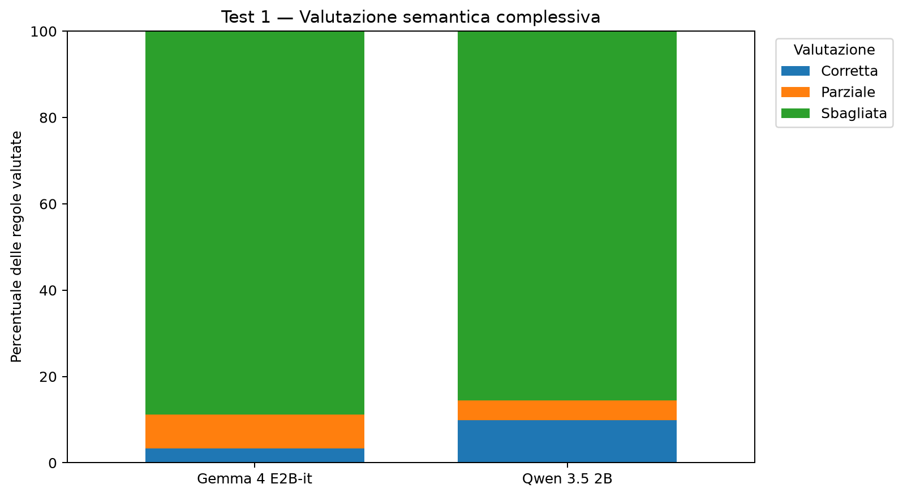
      <br>
      <b>Valutazione semantica totale</b>
    </td>
    <td align="center">
      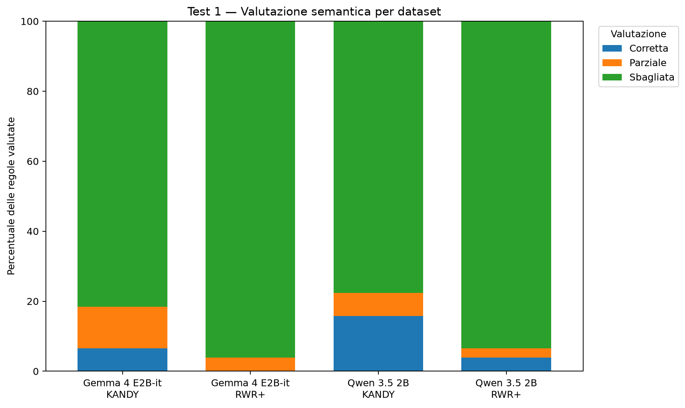
      <br>
      <b>Valutazione semantica dataset</b>
    </td>
    <td align="center">
      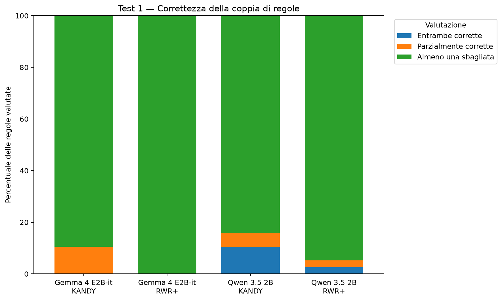
      <br>
      <b>Correttezza coppia regole</b>
    </td>
  </tr>
  <tr>
    <td align="center">
      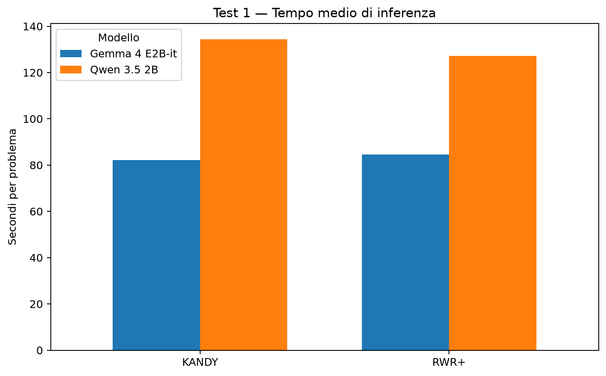
      <br>
      <b>Tempi di inferenza</b>
    </td>
    <td align="center">
      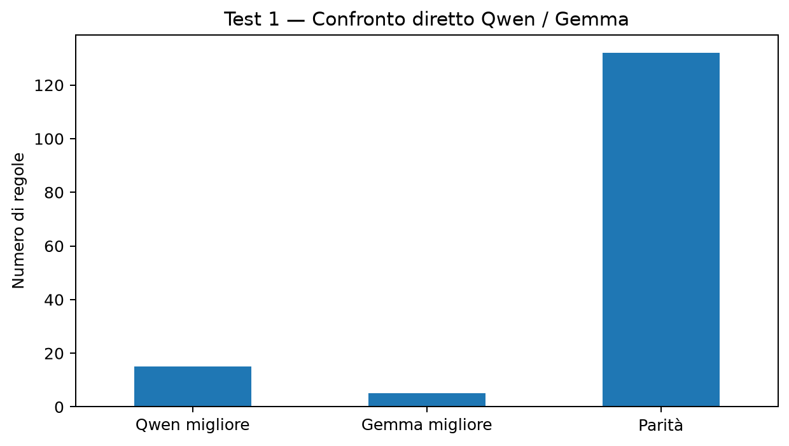
      <br>
      <b>Confronto diretto modelli</b>
    </td>
    <td align="center">
      &nbsp;
    </td>
  </tr>
</table>


Le performance mediocri su questo tipo di task possono essere dovute a vari fattori; un'ipotesi potrebbe essere che ciò è dovuto a tuttte le accortezze che sono state attuate per rendere l'esperimento fattibile sull'hardware disponibile: la scelta stessa di modelli molto piccoli, la quantizzazione sostenuta dei pesi (non così impattante forse), i limiti imposti ai token di ragionamento e la mancata ottimizzazione di quest'ultimi accorgimenti. Un'altra parte importante potrebbe essere l'ottimizzazione dei prompt.

### Secondo Test - Applicazione della regola

In questo secondo esperimento si verifica se il modello sia in grado di applicare una regola già nota a una singola immagine; a differenza del primo test, in cui il modello deve capire le regole che distinguono i due gruppi in modo autonomo, in questo esso riceve entrambe le regole corrette.


<details>
<summary>Prompt di sistema e prompt utente – Test 2</summary>

```python
#prompt di sistema
system_prompt_test2 = """
You are an expert in visual concept recognition and Bongard problems.

Your task is to determine whether a single image satisfies
a given visual concept.

You will receive:
- one image
- one visual rule

Carefully inspect the image and compare its visual properties
with the provided rule.

Do not infer properties that are not visible.
Do not use external knowledge.
Focus only on the visual content of the image and the given rule.

Your answer must be exactly one of the following:
YES
NO

Do not provide explanations, descriptions or additional text.
"""


#prompt utente
def user_prompt_test2(task):

    return f"""
Determine whether the attached image satisfies the following rule:

RULE: {task["rule_text"]}

Answer YES if the image satisfies the rule.
Answer NO if the image does not satisfy the rule.

Return only YES or NO.
"""
```

</details>


Il modello riceve dunque:
- una singola immagine;
- la regola che caratterizza il gruppo LEFT;
- la regola che caratterizza il gruppo RIGHT.

Il compito è quello di stabilire a quale dei due gruppi appartenga l'immagine, restituendo esclusivamente "LEFT" oppure "RIGHT".


<table>
  <tr>
    <td align="center">
      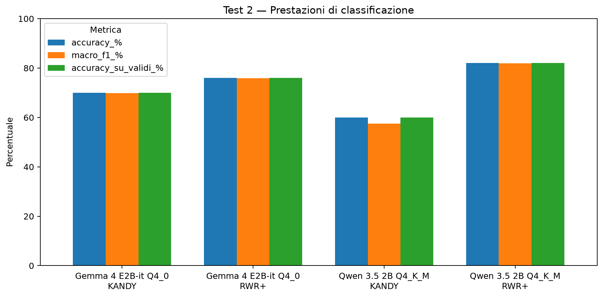
      <br>
      <b>Prestazioni generali</b>
    </td>
    <td align="center">
      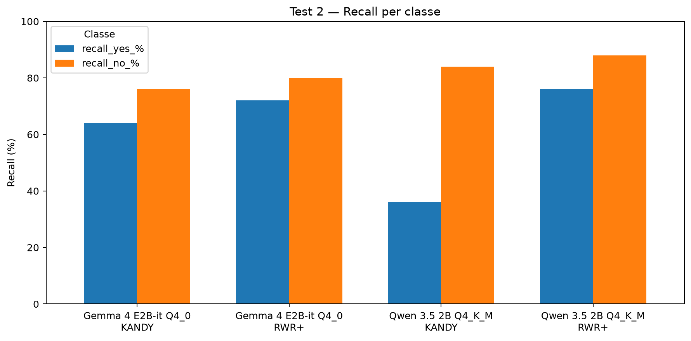
      <br>
      <b>Recall per classe</b>
    </td>
    <td align="center">
      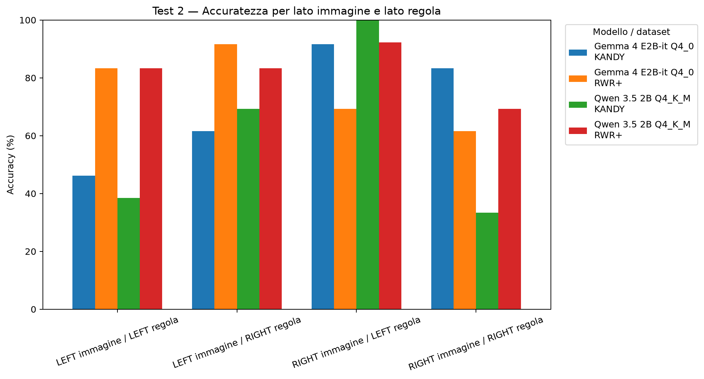
      <br>
      <b>Accuracy lati</b>
    </td>
  </tr>
  <tr>
    <td align="center">
      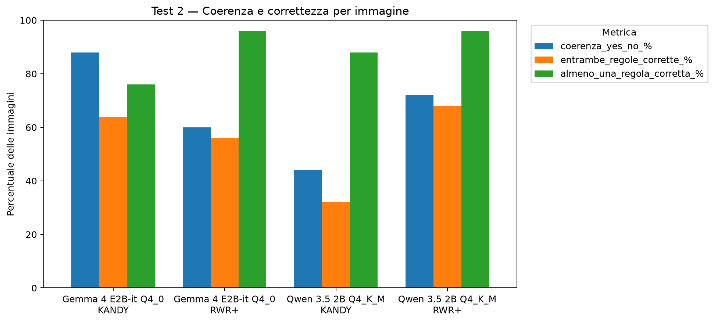
      <br>
      <b>Coerenza per immagine</b>
    </td>
    <td align="center">
      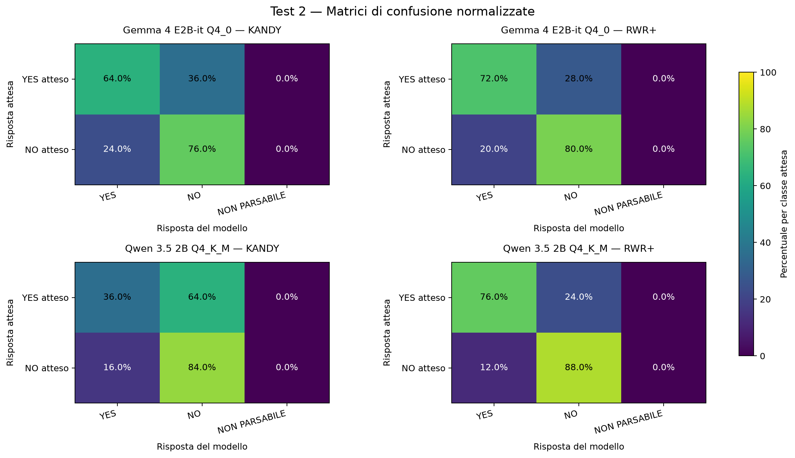
      <br>
      <b>Matrici di confusione</b>
    </td>
    <td align="center">
      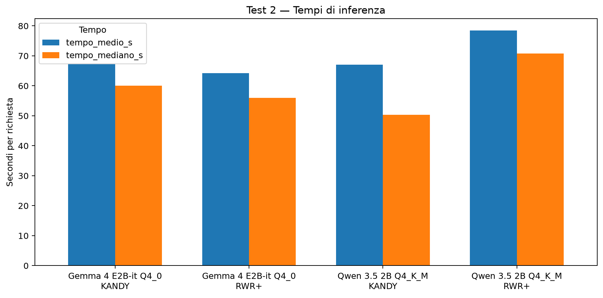
      <br>
      <b>Tempi di inferenza</b>
    </td>
  </tr>
</table>

I due modelli mostrano prestazioni complessivamente simili, ma comportamenti differenti a seconda del dataset: Gemma si dimostra più equilibrato e coerente su KANDY, mentre Qwen ottiene risultati migliori su RWR+; in particolare, Qwen sembra manifestare una tendenza a rispondere NO su KANDY, mostrando così anche una maggiore difficoltà nel riconoscere correttamente i casi positivi, a questo proposito si è analizzata la coerenza delle risposte, osservando che:

- Gemma su KANDY presenta un'elevata coerenza tra le due risposte, ma in alcuni casi inverte completamente l'associazione tra immagine e regola.
- Qwen su KANDY mostra maggiori difficoltà: in molti casi riesce a rispondere correttamente a una delle due richieste, ma non a entrambe.
- Qwen su RWR+ presenta il comportamento migliore: nella maggior parte delle coppie riconosce correttamente entrambe le regole.
- Gemma su RWR+ ottiene risultati intermedi, con numerose coppie in cui soltanto una delle due risposte è corretta.

### Terzo Test - 20 Ipotesi

Nel terzo test, ai due modelli vengono presentate le matrici Bongard di riferimento e viene chiesto di generare 20 coppie di ipotesi, ciascuna composta da una regola che descriva il concetto visivo del gruppo LEFT e una relativa al gruppo RIGHT. Le ipotesi prodotte vengono successivamente valutate per verificarne la correttezza semantica e la capacità di distinguere adeguatamente i due gruppi.


<details>
<summary>System prompt e user prompt – Test 3</summary>

```python
system_prompt_test3 = """
You are an expert in visual concept learning and Bongard problems.

Analyze the attached Bongard matrix.

The first two columns contain the LEFT group.
The last two columns contain the RIGHT group.

Identify the abstract visual distinction between the groups.

Generate 20 distinct candidate hypotheses.

Each hypothesis must contain:
- one concise rule for the LEFT group
- one concise rule for the RIGHT group

Rules must be short, precise and visually grounded.

Prefer simple sentences of approximately 8-12 words per rule.

Consider:
- geometric properties
- colors and patterns
- number of objects
- shapes and orientation
- spatial relationships
- presence or absence of features
- relationships between objects

Do not describe individual images.
Focus on the properties that distinguish the two groups.

Do not use external knowledge.
Do not invent details that are not visible.
"""


user_prompt_test3 = """
Analyze the attached Bongard matrix.

The first two columns represent the LEFT group.
The last two columns represent the RIGHT group.

Generate exactly 20 distinct candidate hypotheses.

Each candidate must contain:
- left_rule: a concise visual rule describing LEFT
- right_rule: a concise visual rule describing RIGHT

Requirements:

1. Generate exactly 20 hypotheses.
2. Include both rules in every hypothesis.
3. Use short and precise descriptions.
4. Avoid introductory text and explanations.
5. Avoid repeating the same hypothesis with minor wording changes.
6. Include different plausible interpretations of the visual distinction.
7. Do not use information external to the images.

Return only a JSON object with the following structure:

{
  "hypotheses": [
    {
      "left_rule": "Short description of LEFT",
      "right_rule": "Short description of RIGHT"
    }
  ]
}

The hypotheses array must contain exactly 20 objects.
Do not include any other fields or text.
"""
```

</details>


<table>
  <tr>
    <td align="center">
      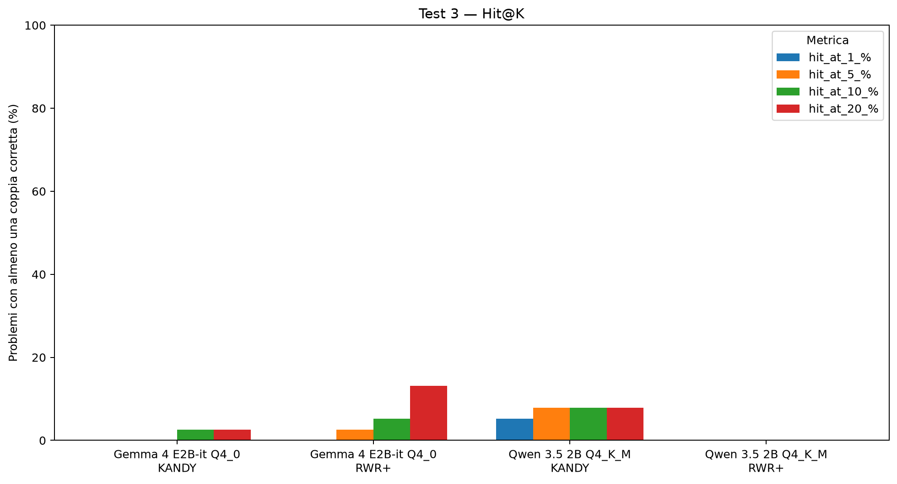
      <br>
      <b>Hit at K</b>
    </td>
    <td align="center">
      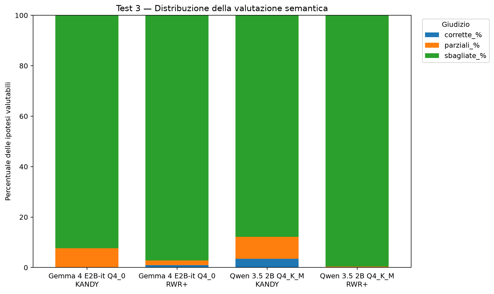
      <br>
      <b>Semantica ipotesi</b>
    </td>
    <td align="center">
      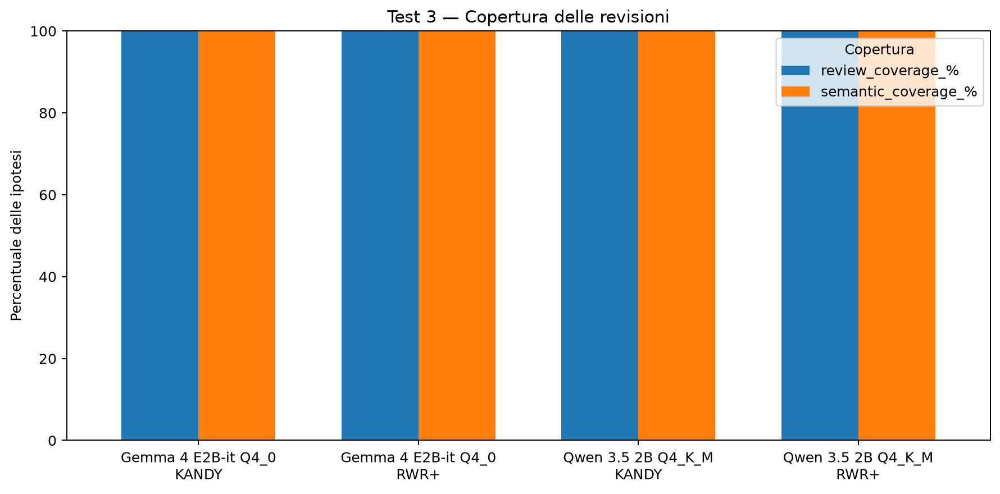
      <br>
      <b>Copertura revisioni</b>
    </td>
  </tr>
  <tr>
    <td align="center">
      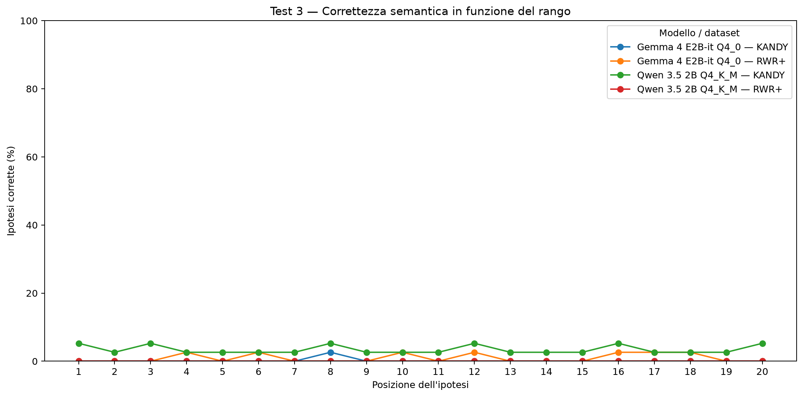
      <br>
      <b>Correttezza per rango</b>
    </td>
    <td align="center">
      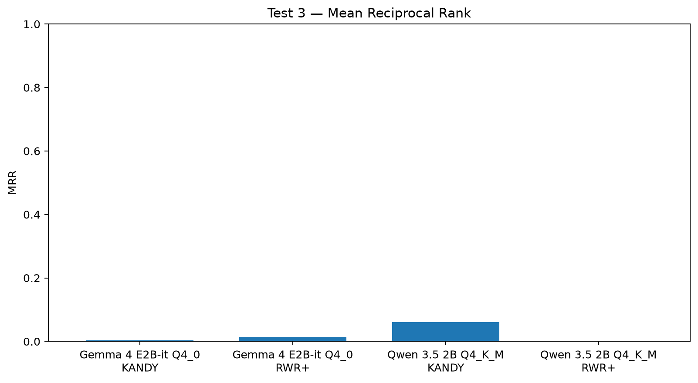
      <br>
      <b>MRR</b>
    </td>
    <td align="center">
      &nbsp;
    </td>
  </tr>
</table>

Entrambi i modelli sembrano riuscire a riconoscere alcuni elementi visivi presenti nelle immagini, ma incontrano grandi difficoltà nel riuscire a produrre un concetto generale astraendo da tali particolari; sembrano tendere a concentrarsi sugli elementi che "spiccano" di più cromaticamente, trascurando talvolta le relazioni o le caratteristiche meno immediate che costituiscono il vero criterio di distinzione. 

**Gemma 4 E2B-it** mostra alcune difficoltà nell'individuazione della regola complessiva. Dall'analisi delle ipotesi generate emerge una tendenza a concentrarsi su proprietà visive isolate, come forme e colori, e a riproporre più volte concetti simili, ciò risulta particolarmente evidente nei problemi in cui la regola dipende da un elemento anomalo o minoritario: ad esempio, quando cinque immagini presentano una determinata caratteristica cromatica e la sesta si distingue dalle altre. Si osserva inoltre una possibile maggiore facilità nell'interpretazione di immagini concrete, RWR+, rispetto a quelle più astratte, KANDY, andando contro ai risultati ottenuti nel test precedente.

**Qwen 3.5 2B** presenta difficoltà evidenti nella generazione di ipotesi diversificate. Il modello tende a riproporre ripetutamente la stessa regola, introducendo soltanto piccole variazioni, soprattutto relative alla forma o al colore degli elementi. In alcuni casi le venti ipotesi generate risultano quindi sostanzialmente sovrapponibili, riducendo la varietà delle soluzioni proposte. Questo fenomeno sembra limitare la capacità del modello di esplorare più alternative posssibili. Questo inoltre, è il motivo per cui Qwen sembra mostrare buone prestazioni su KANDY quando si analizzano i risultati ipotesi per ipotesi: Qwen ripete 20 volte la stessa ipotesi, se essa è corretta, ha dato la risposta corretta 20 volte. Nei problemi RWR+, al contrario, non emerge alcun risultato positivo. 

Non emerge quindi una superiorità assoluta di un modello, ma una diversa sensibilità rispetto alla tipologia di problemi affrontati.

### Quarto Test - Dataset Mixati 

Nel quarto test viene valutata la capacità di applicare la regola astratta a un target concreto: a ogni richiesta vengono presentate due immagini composte da esempi appartenenti rispettivamente ai gruppi LEFT e RIGHT di una matrice Bongard del dataset KANDY, viene poi proposta una terza immagine, proveniente dal dataset RWR+, la quale costituisce il target da classificare. Il modello deve quindi individuare la caratteristica visiva o la relazione che distingue i due gruppi di riferimento e applicarla all'immagine target, stabilendo se questa appartenga al gruppo LEFT oppure al gruppo RIGHT.


<details>
<summary>System prompt e user prompt – Test 4</summary>

```python
#prompt di sistema
system_prompt_test4 = """
You are an expert in visual concept recognition and Bongard problems.

Your task is to classify a target image using two groups of visual examples.

You will receive three images:
1. A contact sheet containing examples from the LEFT group.
2. A contact sheet containing examples from the RIGHT group.
3. A single target image to classify.

The examples come from KANDY.
The target image comes from a different visual dataset.

Your task is to transfer the visual concept distinguishing the
LEFT and RIGHT groups to the target image.

First, identify the visual property or relationship that
distinguishes the two context groups.

Then examine the target image and determine which of these
two concepts it is more consistent with.

IMPORTANT:
- Do not classify based only on object identity or image category.
- Do not assume that the target must look similar to the examples
  in terms of background, photographic style or depicted objects.
- Focus on potentially transferable visual properties and
  relationships, such as color, shape, number, arrangement,
  orientation, size, composition and spatial relationships.
- Compare the target against the distinguishing features of
  BOTH groups.
- Do not conclude that neither group applies. You must select
  the group that best matches the relevant visual concept.
- Do not invent visual properties that cannot be observed.
- Do not use external knowledge.

You must make exactly ONE classification.

The classification field must contain exactly one of these values:
LEFT
RIGHT

The text "LEFT or RIGHT" is NOT a valid classification.
Never reproduce both alternatives in the answer.

Your answer must follow exactly this format:

CLASSIFICATION: [ONE CHOICE]
EXPLANATION: [One or two concise sentences, maximum 35 words.]

Explain which visible property or relationship supports
your classification.

Do not include any additional text.
"""


#prompt utente
user_prompt_test4 = """
The first attached image contains examples from the LEFT group.
The second attached image contains examples from the RIGHT group.
The third attached image is the target.

Determine which group the target belongs to.

Compare the distinguishing visual properties of both context
groups with the target.

Remember that the target comes from a different dataset.
Its objects and visual style may differ from the context images.

Look for the underlying visual property or relationship that
transfers across the two datasets.

You MUST choose exactly one group.

Return exactly two fields:

CLASSIFICATION: LEFT

or

CLASSIFICATION: RIGHT

Choose only one of these classifications.
Do not write "LEFT or RIGHT" in the classification field.

EXPLANATION: Briefly describe the visible feature or relationship
that supports your choice.

Do not provide additional text.
"""
```

</details>


| Modello | Predizioni LEFT | Predizioni RIGHT | Accuratezza | Comportamento osservato |
|---|---:|---:|---:|---|
| Gemma 4 E2B-it | 6 | 0 | 50% | Tendenza costante verso LEFT |
| Qwen 3.5 2B | 0 | 6 | 50% | Tendenza costante verso RIGHT |


Entrambi i modelli hanno ottenuto un'accuratezza del 50% ma tale risultato non mostra un'effettiva capacità di generalizzazione, infatti Gemma ha classificato tutti i target come LEFT, mentre Qwen li ha classificati tutti come RIGHT. Entrambi hanno quindi riconosciuto correttamente soltanto i tre esempi appartenenti al lato selezionato sistematicamente, senza riuscire a distinguere i due target relativi allo stesso problema.

L'analisi delle spiegazioni evidenzia difficoltà nell'individuare caratteristiche astratte trasferibili tra i due dataset. I modelli tendono a concentrarsi sulle differenze superficiali tra le immagini, come la presenza di figure geometriche nei contesti KANDY e di fotografie di oggetti o persone nei target RWR+, senza riuscire a stabilire un criterio discriminante coerente.


<details>
<summary>Esempio di classificazione errata – easy-2__Q08</summary>

**Gemma – classificazione LEFT con Target RIGHT (errata)**

> The visual concept is the presence of small, colored circular elements on a gray background. The target image does not contain these elements, but the concept of a distinct colored mark on a neutral field is the transferable property.

Il modello riconosce esplicitamente che il target non contiene gli elementi che descrive come caratteristici, ma assegna comunque l'immagine a LEFT.

</details>


Dal punto di vista tecnico, Gemma ha completato tutte le risposte senza troncamenti, mentre Qwen ha raggiunto il limite massimo di generazione in quattro episodi su sei, producendo spiegazioni lunghe e che, spesso, ripetono la stessa frase più volte.

Nel complesso, il test evidenzia difficoltà significative nel trasferimento di concetti visivi tra dataset differenti.

## Riassunto Risultati Seconda Parte

I quattro esperimenti hanno permesso di valutare diverse capacità dei VLM: individuazione autonoma delle regole, applicazione a singole immagini, generazione di ipotesi e trasferimento dei concetti tra dataset differenti. Nel complesso, i risultati evidenziano difficoltà soprattutto nei compiti che richiedono di individuare concetti astratti e generalizzarli a contesti visivi diversi.

Test 1 – Induzione della regola: entrambi i modelli mostrano difficoltà nell'individuare le regole astratte, soprattutto su RWR+, dove tendono a concentrarsi sugli oggetti rappresentati anziché sulle proprietà che distinguono i gruppi.

Test 2 – Applicazione della regola: le prestazioni complessive sono simili, ma Gemma risulta più equilibrato su KANDY, mentre Qwen ottiene risultati migliori su RWR+. Quest'ultimo mostra inoltre una tendenza a rispondere NO nei problemi KANDY.

Test 3 – Generazione di 20 ipotesi: entrambi i modelli faticano a produrre regole corrette e diversificate. Gemma tende a ripetere ipotesi simili, mentre Qwen presenta ripetizioni particolarmente marcate, che possono alterare l'interpretazione delle metriche.

Test 4 – Generalizzazione cross-dataset: entrambi i modelli ottengono il 50% di accuratezza, ma adottano strategie di classificazione costanti: Gemma assegna tutti i target a LEFT, Qwen a RIGHT. Non emerge quindi una reale capacità di distinguere i due gruppi.

Considerazione generale: i risultati suggeriscono che la capacità di descrivere gli elementi visivi o applicare una regola già fornita non implichi necessariamente la capacità di individuare autonomamente un concetto astratto e trasferirlo a immagini differenti.

## Possibili Miglioramenti

Dai risultati ottenuti emergono alcuni aspetti che potrebbero essere approfonditi per migliorare le performance dei modelli e la comprensione degli stessi.
Si rilevano i seguenti possibili miglioramenti.

- Prompt engineering: perfezionare le istruzioni fornite ai modelli, soprattutto nei test di induzione e generalizzazione, per favorire l'individuazione di proprietà astratte anziché semplici somiglianze visive.

- Generazione delle ipotesi: introdurre controlli per individuare ed eliminare le ipotesi semanticamente ripetute, valutando anche la diversità delle regole generate e non soltanto la loro correttezza.

- Gestione dei token: rivedere il budget di generazione e di ragionamento, cercando un compromesso tra qualità delle risposte, lunghezza delle spiegazioni e tempi di inferenza.

- Ampliamento del dataset misto: aumentare il numero di problemi del Test 4, eventualmente generando nuove immagini KANDY attraverso il generatore YAML, in modo da rappresentare concetti presenti anche in RWR+.

---